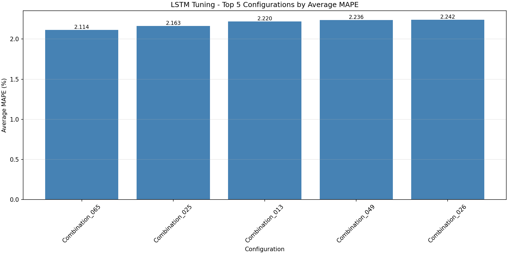

# LSTM Tuning Comparison
Documentation of hyperparameter tuning experiments for the LSTM model on daily stock price forecasting. The goal of this experiment is to test the model's sensitivity to hyperparameter choices, rather than to maximize absolute performance.

## 1. Parameters
Unlike traditional models, LSTM has no order selected via an information criterion. Its behavior is instead governed by architecture and training hyperparameters. This experiment tunes the four most influential architecture hyperparameters through a full grid search.

Because neural networks involve stochastic elements, random weight initialization, dropout, and batch shuffling, a fixed random seed (seed = 1) was set to ensure reproducibility and a fair comparison across configurations.

This experiment tunes the four most influential architecture hyperparameters through a full grid search.

This experiment tests the following parameters:
| No | Parameter | Values Tested | Reason |
|---|---|---|---|
| 1 | Window Size | 20, 40, 60 | To test how much historical context (in trading days) the model uses per prediction |
| 2 | Units | 32, 64, 128 | To test model capacity of neurons per layer, more units capture more complex patterns but risk overfitting |
| 3 | Layers | 1, 2, 3 | To test model depth, more layers capture higher-level patterns but increase overfitting risk on limited data |
| 4 | Dropout Rate | 0.1, 0.2, 0.3, 0.4 | To test the strength of regularization against overfitting |

Following standard practice, other training parameters like batch size, Adam Optimizer, and max epochs are set with a fixed value.

## 2. Experiment Configurations
A full grid search of the four parameters produces 3 × 3 × 3 × 4 = 108 configurations, named Combination_001 to Combination_108. Each configuration is run across all 10 tickers using an (80% training / 10% validation / 10% testing) split. Due to the large number of configurations, only the top 5 (lowest average MAPE) are highlighted below; the complete ranking is available in the raw results.

## 3. Results by Configuration
### 3.1 Top 5 Configurations by Average MAPE
| Rank | Configuration | Window | Units | Layers | Dropout | MAE | MSE | RMSE | MAPE |
|---|---|---|---|---|---|---|---|---|---|
| 1 | Combination_025 | 20 | 128 | 1 | 0.1 | 62.2989 | 11978.0320 | 88.5785 | 1.5553 |
| 2 | Combination_013 | 20 | 64 | 1 | 0.1 | 69.8529 | 15299.1379 | 95.4439 | 1.6025 |
| 3 | Combination_061 | 40 | 128 | 1 | 0.1 | 64.1899 | 11871.8813 | 89.2680 | 1.6161 |
| 4 | Combination_065 | 40 | 128 | 2 | 0.1 | 65.2806 | 12529.3717 | 89.9015 | 1.6260 |
| 5 | Combination_028 | 20 | 128 | 1 | 0.4 | 73.3894 | 17914.0778 | 100.0105 | 1.6524 |

The best configuration was Combination_025 (window=20, units=128, layers=1, dropout=0.1) with an average MAPE of 1.5553%. Across all 108 configurations, MAPE ranged from 1.5553% (best) to 3.1037% (worst) — a spread of about 1.55 percentage points, indicating that unlike the traditional models, LSTM performance is genuinely sensitive to hyperparameter choices.

### 3.2 Plot
The top 5 configurations by average MAPE are summarised in the bar chart below:

### 3.3 Effect of Each Parameter
The average MAPE grouped by each parameter value (across all configurations) reveals clear trends:

| Window | Avg MAPE | Units | Avg MAPE | Layers | Avg MAPE | Dropout | Avg MAPE |
|---|---|---|---|---|---|---|---|
| 20 | 2.0408 | 32 | 2.3632 | 1 | 1.8145 | 0.1 | 1.9111 |
| 40 | 2.0794 | 64 | 2.0698 | 2 | 2.0877 | 0.2 | 2.0412 |
| 60 | 2.1801 | 128 | 1.8673 | 3 | 2.3982 | 0.3 | 2.1542 |
| | | | | | | 0.4 | 2.2939 |

## 4. Analysis

### 4.1 Effect of Window Size
Shorter windows performed slightly better: window=20 averaged 2.04% MAPE, window=40 averaged 2.08%, and window=60 averaged 2.18%. All top-5 configurations used a window of 20 or 40; none used 60. This suggests that for daily stock prediction, a shorter historical context (roughly 1–2 months) is sufficient, and longer windows add mostly noise rather than useful signal — consistent with the short-memory, near-random-walk nature of daily prices.

### 4.2 Effect of Units
More units improved performance: 128 units averaged 1.87% MAPE, versus 2.06% for 64 and 2.36% for 32. Every top-5 configuration except one used 128 units. This indicates the model benefits from higher capacity to capture the multivariate OHLCV relationships, and 128 units did not overfit within the tested range.

### 4.3 Effect of Layers
Fewer layers performed clearly better: 1 layer averaged 1.81% MAPE, 2 layers 2.09%, and 3 layers 2.40%. Four of the top five configurations used a single LSTM layer. This is a strong and important finding: additional depth consistently *hurt* performance, almost certainly because deeper models overfit the limited training data (~1,000 examples per ticker). It confirms that a simple, shallow architecture is best suited to this data.

### 4.4 Effect of Dropout Rate
Lower dropout performed better: 0.1 averaged 1.91% MAPE, rising steadily to 2.29% at dropout 0.4. All top-5 configurations except one used dropout 0.1. Since the best models were already shallow (1 layer) and thus less prone to overfitting, heavy regularization was unnecessary and only degraded performance.

### 4.5 Overall Sensitivity
Unlike the traditional models (ARIMA/SARIMA), where all configurations performed within noise, LSTM showed genuine sensitivity to its hyperparameters, with MAPE ranging from 1.56% to 3.10% across the grid. The clear pattern is that simpler, higher-capacity-but-shallow models with light regularization performed best: short window, 128 units, 1 layer, low dropout.

## 5. Conclusion
The LSTM tuning revealed clear and consistent trends, in contrast to the traditional models. The best configuration was Combination_025 (window=20, units=128, layers=1, dropout=0.1), achieving an average MAPE of 1.5553%. The dominant findings were that shallower models (1 layer) substantially outperformed deeper ones, higher unit counts (128) helped, shorter windows (20) were marginally better than longer ones, and low dropout (0.1) was preferable. Together these indicate that the limited size of the daily stock dataset favors a simple, shallow, higher-capacity architecture with minimal regularization; added depth and heavy dropout consistently degraded performance through overfitting. Combination_025 was therefore selected as the configuration for the final LSTM model.

## Raw Full Results
Complete raw results are available in `results/lstm_tuning_full.csv` (all 108 configurations × 10 tickers) and `results/lstm_tuning_ranked.csv` (configurations ranked by average MAPE).