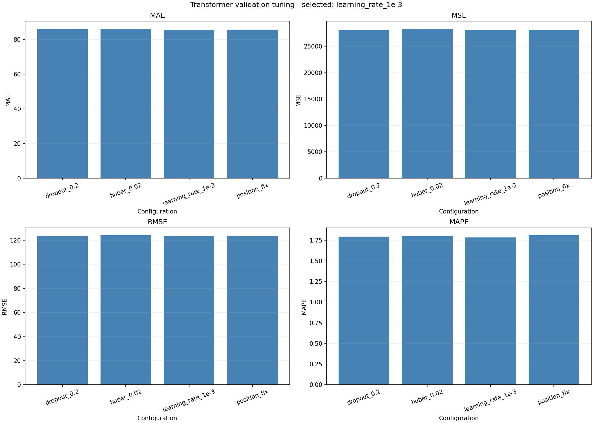

# Transformer Tuning Comparison

This experiment preserves the tuned Transformer notebook and its completed Colab outputs separately from the original model. The original notebook remains at models/TRANSFORMER/transformer_thesis (fix).ipynb and matches the historical committed version.

## 1. Experiment setup

- Notebook: [transformer_tuning.ipynb](transformer_tuning.ipynb).
- Data: ten IDX banking and energy stocks, daily OHLCV, 1 April 2020 through 30 December 2025.
- Chronological split: 80% training, 10% validation, 10% testing (1,107 / 138 / 139 observations per stock).
- Test period: 12 June through 30 December 2025; all 139 test dates are evaluated.
- Inputs: 30 preceding observations; volume receives log1p, then MinMax scaling fitted on training observations only.
- Target: unscaled close-to-close log return; predicted prices are reconstructed using the previous actual close.
- Architecture: one encoder block, model dimension 32, two attention heads, feed-forward dimension 64, learned positional embeddings, last-position readout and Dense regression output.
- Training: Adam, Huber loss, maximum 100 epochs, batch size 32, early stopping with patience 10, and seed 42.
- Evaluation: rolling one-step predictions with fixed trained weights and updated actual input observations.

## 2. Configurations and selection

Four candidate configurations change one setting at a time from position_fix. This is a limited candidate search, rather than a full factorial grid search. All candidates include the corrected trainable positional embeddings.

| config | learning_rate | dropout | huber_delta |
| --- | --- | --- | --- |
| position_fix | 0.0005 | 0.1000 | 1.0000 |
| learning_rate_1e-3 | 0.0010 | 0.1000 | 1.0000 |
| dropout_0.2 | 0.0005 | 0.2000 | 1.0000 |
| huber_0.02 | 0.0005 | 0.1000 | 0.0200 |

Forty tuning fits cover four configurations and ten stocks. Selection uses mean validation MAPE across stocks, with validation RMSE as the tie-breaker. The selection is frozen before test evaluation.

| config | MAE | MSE | RMSE | MAPE |
| --- | --- | --- | --- | --- |
| learning_rate_1e-3 | 85.5671 | 28075.0586 | 123.4039 | 1.7841 |
| dropout_0.2 | 85.8066 | 28061.5389 | 123.3986 | 1.7950 |
| huber_0.02 | 86.1853 | 28350.5779 | 124.1554 | 1.7962 |
| position_fix | 85.7076 | 28051.2126 | 123.5899 | 1.8097 |

Selected configuration: **learning_rate_1e-3** (learning rate 0.001, dropout 0.1, Huber delta 1.0).

## 3. Selected-model test results

| ticker | MAE | MSE | RMSE | MAPE | Naive MAPE |
| --- | --- | --- | --- | --- | --- |
| ADRO | 31.8586 | 2099.1475 | 45.8165 | 1.7417 | 1.7167 |
| BBCA | 97.6989 | 16913.8081 | 130.0531 | 1.1886 | 1.1967 |
| BBNI | 56.8692 | 6392.4616 | 79.9529 | 1.3435 | 1.3422 |
| BBRI | 52.9228 | 4947.6307 | 70.3394 | 1.3703 | 1.3568 |
| BBTN | 22.8195 | 1032.6463 | 32.1348 | 1.8778 | 1.8864 |
| BMRI | 61.6507 | 6818.4565 | 82.5739 | 1.3148 | 1.2999 |
| ITMG | 155.0915 | 49993.5222 | 223.5923 | 0.6865 | 0.6793 |
| MEDC | 26.2370 | 1304.9589 | 36.1242 | 1.9882 | 1.9396 |
| PGAS | 23.5382 | 1111.2986 | 33.3361 | 1.3785 | 1.3799 |
| PTBA | 24.4072 | 2145.2532 | 46.3169 | 1.0137 | 0.9245 |

Mean test MAPE is **1.3904%**. Persistence (predicting the previous close) has mean MAPE **1.3722%**. The tuned model beats persistence on MAPE for 3 of 10 stocks, so the results do not establish a consistent advantage over that baseline. Only one seed was evaluated.

### Sector averages

| sector | MAE | MSE | RMSE | MAPE |
| --- | --- | --- | --- | --- |
| Banking | 58.3922 | 7221.0006 | 79.0108 | 1.4190 |
| Energy | 52.2265 | 11330.8361 | 77.0372 | 1.3617 |

MAPE provides the scale-independent comparison. MAE, MSE and RMSE averages also depend on the price scales of the stocks in each sector.

### Comparison with the saved model results

| Model | MAE | MSE | RMSE | MAPE |
| --- | --- | --- | --- | --- |
| ARIMA | 54.8706 | 9346.3731 | 78.0035 | 1.3769 |
| SARIMAX | 55.1159 | 9320.4944 | 78.0845 | 1.3875 |
| Tuned Transformer | 55.3094 | 9275.9184 | 78.0240 | 1.3904 |
| SARIMA | 55.3181 | 9316.2038 | 78.2773 | 1.4009 |
| ARIMAX | 55.1806 | 9287.6512 | 78.1080 | 1.4029 |
| GRU | 58.6776 | 10501.0469 | 82.9047 | 1.4687 |
| LSTM | 76.3738 | 21884.1261 | 104.7806 | 1.6633 |

These are descriptive comparisons with the saved repository evaluation CSVs. The tuned Transformer uses the shared 80/10/10 split; model architectures, targets, tuning and refitting procedures differ.

## 4. Historical Transformer comparison

| ticker | Old MAPE | New MAPE | MAPE Reduction (%) |
| --- | --- | --- | --- |
| ADRO | 2.1096 | 1.7417 | 17.4423 |
| BBCA | 1.3371 | 1.1886 | 11.1045 |
| BBNI | 1.7053 | 1.3435 | 21.2185 |
| BBRI | 1.6805 | 1.3703 | 18.4564 |
| BBTN | 2.5109 | 1.8778 | 25.2117 |
| BMRI | 1.6113 | 1.3148 | 18.4048 |
| ITMG | 0.8872 | 0.6865 | 22.6212 |
| MEDC | 1.9269 | 1.9882 | -3.1816 |
| PGAS | 1.4569 | 1.3785 | 5.3831 |
| PTBA | 1.0854 | 1.0137 | 6.6047 |

The historical average MAPE is 1.6311%, compared with 1.3904% for the tuned experiment, a relative historical reduction of 14.76%. The old run used 70/15/15 and a different test period, while this run uses 80/10/10. This difference cannot isolate the effect of tuning. The original results/Transformer_evaluation (fix).csv remains unchanged; the exported historical reference uses six-decimal metrics embedded in the notebook.

## 5. Saved outputs and rerunning

- [Validation results](results/transformer_tuning.csv) and [configuration averages](results/transformer_tuning_averages.csv).
- [Standard evaluation CSV](results/TRANSFORMER_evaluation.csv), [seed-level test results](results/TRANSFORMER_runs.csv), and [historical comparison](results/TRANSFORMER_historical_comparison.csv).
- Per-stock prediction CSVs in results/predictions/; actual-versus-predicted PNGs in results/plots/; training-loss PNGs in results/plots/training/.

The imported CSVs and PNGs are copied without changing their contents. The notebook retains its saved training logs, evaluation output and ten embedded prediction plots.

Run the notebook on Colab to reproduce the experiment. With the completed runtime files still available, run only the final export cell to rebuild the files and ZIP without training. All repository exports from this notebook stay under tuning/TRANSFORMER/results/. Download transformer_outputs.zip from the printed runtime path and extract it into the repository root.

The downloaded output bundle does not include model checkpoints or raw epoch-history CSVs. Those remain in the original runtime or Drive run directory; plotting new training curves requires those files.
